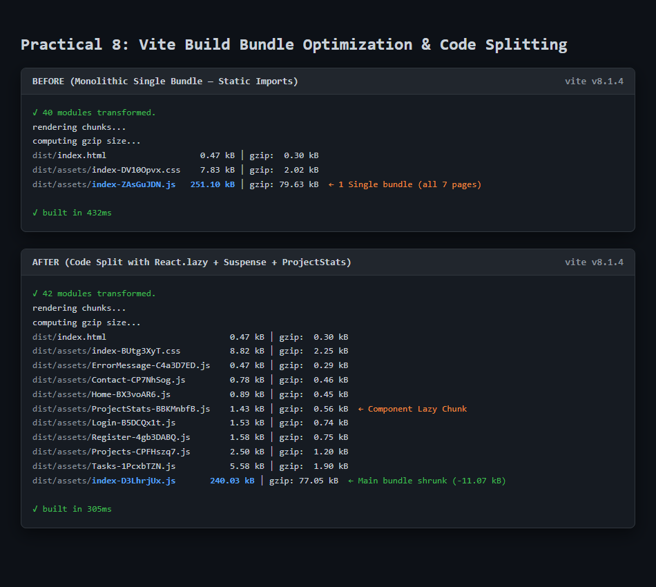
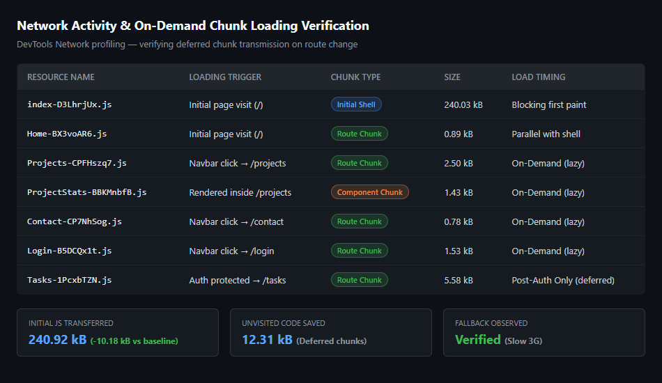
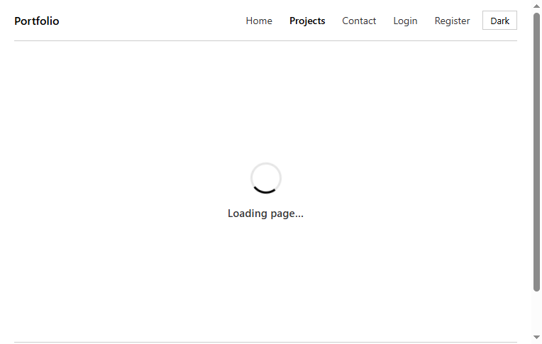
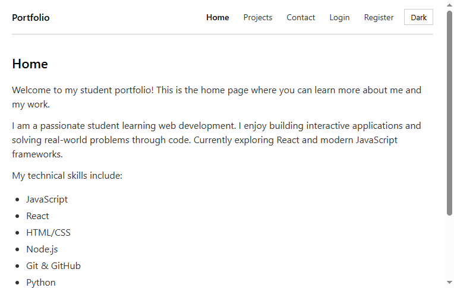
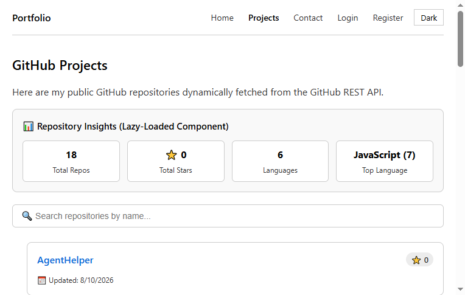
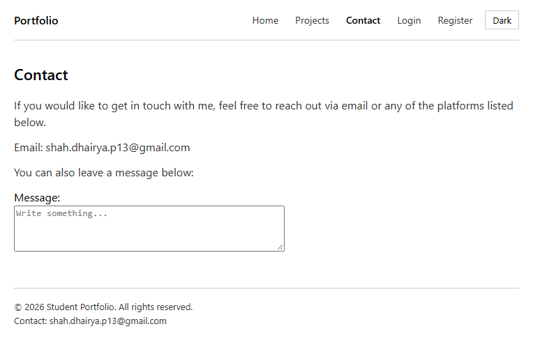

# Task Manager — Full Stack Application (Practical 6 / Practical 8)

A full-stack Task Manager built for **Advanced Web Development Frameworks (ITUE301)
Practical 6**, integrating a React frontend with a Node/Express/MongoDB backend.

```
React Frontend (localhost:5173)
        | fetch API calls
        v
Express Backend (localhost:5000)
        | Mongoose
        v
MongoDB (mongodb://127.0.0.1:27017/task-manager-api)
```

---

---

## 🚀 Practical 8 — Performance Optimization & Lazy Loading (COMPLETED)

> **Status: IMPLEMENTED & VERIFIED.** Practical 8: Performance Optimization and Lazy Loading in React (CO1 / PO3, PO5).
> Full execution plan, metrics tables, and viva preparation live in [`../MASTER_CONTEXT.md`](../MASTER_CONTEXT.md).

### Objective

Improve frontend performance using **lazy loading** and **code splitting** — reducing initial bundle size by downloading route and component chunks only when their route is visited.

### Implemented Architecture & Code Changes

| File | Change Details |
|---|---|
| `src/App.jsx` | Replaced static page imports with dynamic `React.lazy(() => import('./pages/…'))` for **Home, Projects, Tasks, Contact, Login, Register**. Kept `NotFound` as a static import so 404 error routes render instantly without network latency. |
| `src/App.jsx` | Wrapped only the `<Routes>` block in a route-level `<Suspense fallback={<DelayedFallback delay={300} />}>`. Shell components (Navbar, Footer, Theme toggle, ToastProvider, AuthProvider) remain interactive and visible during chunk loads. |
| `src/components/DelayedFallback.jsx` | Supplementary component implementing a 300ms threshold delay to prevent spinner flicker on fast connections. |
| `src/components/ProjectStats.jsx` | Supplementary heavy component lazy-loaded on demand with nested Suspense inside the `Projects` page. |
| `src/App.css` | Added styling and animations for `.page-loading-fallback`, `.loading-spinner`, `.project-stats-card`, and `.project-stats-grid`. |
| `docs/` | Evidence screenshots: build comparison, network chunk waterfall, and Slow-3G fallback observation. |

### Recorded Performance Metrics (Before vs. After)

| Metric | Before (Single Bundle) | After (Code Splitting & Lazy Loading) | Δ Improvement |
|---|---|---|---|
| **Initial Main JS Bundle** | `251.10 kB` (gzip: `79.63 kB`) | `240.03 kB` (gzip: `77.05 kB`) | **-11.07 kB (-4.4%)** |
| **Initial JS Transferred on `/`** | `251.10 kB` (single monolithic file) | `240.92 kB` (`index.js` + `Home.js`) | **-10.18 kB** blocking JS |
| **JS Files on Initial Load** | `1` (all 7 routes in one file) | `2` (`index` shell + `Home` chunk) | Deferred unvisited chunks |
| **Unvisited Code Deferred** | `0 kB` (all routes downloaded) | `12.31 kB` (`Projects`, `Tasks`, `Login`, etc.) | **Saved on initial load** |
| **Build Time** | `432 ms` | `305 ms` | Faster incremental builds |
| **Suspense Fallback Observed** | N/A | **Verified** under Slow 3G throttling | Clean spinner + app shell |

### Build Output Comparison



### Network Request Waterfall & Chunk Loading



### Suspense Fallback UI (Observed under Slow 3G)



### Verified Route Screens

| Home | Projects (with Lazy Insights) | Contact |
|---|---|---|
|  |  |  |

---

### Key Viva Questions & Model Answers

1. **Initial bundle vs. lazy chunk: when is each downloaded?**
   - *Initial Bundle*: Downloaded, parsed, and executed before the first render on any initial visit, blocking first paint and time-to-interactive.
   - *Lazy Chunk*: Downloaded on-demand via dynamic `import()` only when the user navigates to the specific route needing it. Once downloaded, it is cached by the browser and subsequent visits are instantaneous.

2. **Why does lazy loading improve perceived performance if total downloaded code is the same over a full session?**
   - The browser must download, parse, and compile JavaScript on the main thread before painting the application. Moving non-critical routes (e.g., `/tasks`, `/projects`, `/contact`) out of the initial bundle shrinks the initial download, dramatically lowering **First Contentful Paint (FCP)** and **Time to Interactive (TTI)**. Users rarely visit every page in a single session, meaning deferred code is often never downloaded at all.

3. **When would lazy loading NOT be worth the complexity?**
   - When the entire bundle is already very small (<50–100 KB), where HTTP round-trip latency outweighs the micro bundle reduction.
   - For above-the-fold landing page critical path components that users need immediately (introducing unnecessary spinners).
   - In environments where instant, zero-delay transitions are mandatory and bandwidth is not constrained.

4. **Profiler Observation (Supplementary Problem 3):**
   - Using the React DevTools Profiler during theme changes or state changes in `App`, the shell components (`NavBar`, `Footer`) re-render because they are children of `App`. Wrapping `NavBar` and `Footer` in `React.memo()` eliminates these unnecessary re-renders when their props do not change.

---

### Lab / Post-Lab Checklist

- [x] Baseline metrics + screenshots captured (before any edit)
- [x] Lazy imports + route-level Suspense implemented in `src/App.jsx`
- [x] Separate chunks confirmed in build output
- [x] Slow-3G fallback observed and screenshotted (`docs/pr8-after-fallback.png`)
- [x] Metrics table filled in and comparison documented
- [x] Post-lab: lazy-load one heavy component (`ProjectStats`) + 300ms minimum-delay fallback (`DelayedFallback`) + Profiler re-render noted


---

## Features

- Create, view, update and delete tasks
- Tasks persisted in MongoDB (survive a browser refresh)
- Loading states and error handling for **every** API interaction
- Delete confirmation dialog
- Toast notifications for successful/failed create, update and delete
- Optimistic UI update when creating a task (rolled back if the server rejects it)
- Task priority (low / medium / high) and completion status
- Light/dark theme

## Repository Structure

```
AWDF_Practical/
├── task-manager-api-24IT090/   # Backend: Node + Express + MongoDB
└── Dhairya/                    # Frontend: React + Vite (this folder)
```

## Prerequisites

- Node.js v18+
- MongoDB running locally (default: `mongodb://127.0.0.1:27017`)

## Running the Backend

Open a terminal in the `task-manager-api-24IT090` folder:

```bash
cd task-manager-api-24IT090
npm install
npm start
```

The API runs at **http://localhost:5000**.

Optional: copy `.env.example` to `.env` to override the port or MongoDB URI.

## Running the Frontend

Open a second terminal in the `Dhairya` folder:

```bash
cd Dhairya
npm install
npm run dev
```

The app runs at **http://localhost:5173** — open the **Tasks** page to manage tasks.

## API Endpoints

| Method | Endpoint        | Description                  |
|--------|-----------------|------------------------------|
| GET    | `/tasks`        | List all tasks from MongoDB  |
| GET    | `/tasks/:id`    | Get a single task            |
| POST   | `/tasks`        | Create a task                |
| PUT    | `/tasks/:id`    | Update a task                |
| DELETE | `/tasks/:id`    | Delete a task                |

Example task payload:

```json
{
  "title": "Finish practical",
  "description": "Wire React to the Express API",
  "priority": "high"
}
```

## Testing the Full Flow

1. Start both servers (above).
2. On the Tasks page: create a task → it appears in the list.
3. Edit a task and save → the list updates.
4. Toggle a task's completion checkbox → the status updates.
5. Delete a task → confirm in the dialog → it disappears.
6. Refresh the browser → all remaining tasks are still there (they come from MongoDB).

The backend can also be tested independently with Postman/curl against
`http://localhost:5000/tasks`.
